# Jubilee Digital Twin — Smart Microscopy Workshop


---

## Install Blender

The twin is driven by Blender (version **5.0 or newer**).

1. Go to <https://www.blender.org/download/> and download the installer for the OS.
2. Run the installer and keep the default options.
   - **Windows:** Blender is installed to
     `C:\Program Files\Blender Foundation\Blender 5.X\`.
   - **macOS:** drag `Blender.app` into `Applications`.
   - **Linux:** extract the `.tar.xz` anywhere (or use the package manager).
3. Launch Blender once to make sure it opens, then close it.


### Add Blender to the PATH (recommended)

The `jubilee-twin` command launches Blender itself, so it needs to find the `blender` executable. The simplest way is to add Blender's folder to the PATH.

**Windows**

1. Open *Settings → System → About → Advanced system settings*.
2. Click *Environment Variables…*.
3. Under *System variables*, select `Path` → *Edit* → *New*.
4. Paste `C:\Program Files\Blender Foundation\Blender 5.X` (replace `X` with the installed version) and click *OK* on every dialog.


**macOS** — add this line to `~/.zshrc`:

```bash
export PATH="/Applications/Blender.app/Contents/MacOS:$PATH"
```

**Linux** — Blender is usually already on PATH if installed via a package manager. Otherwise add the extracted folder to `~/.bashrc`.

Open a **new** terminal and verify:

```bash
blender --version
```

---

## Download the repository (ZIP)

No Git required — we download the repository as a ZIP archive.

1. Open <https://github.com/Jubilee-CSL/jubilee-blender-twin>.
2. Click the green **Code** button → **Download ZIP**.

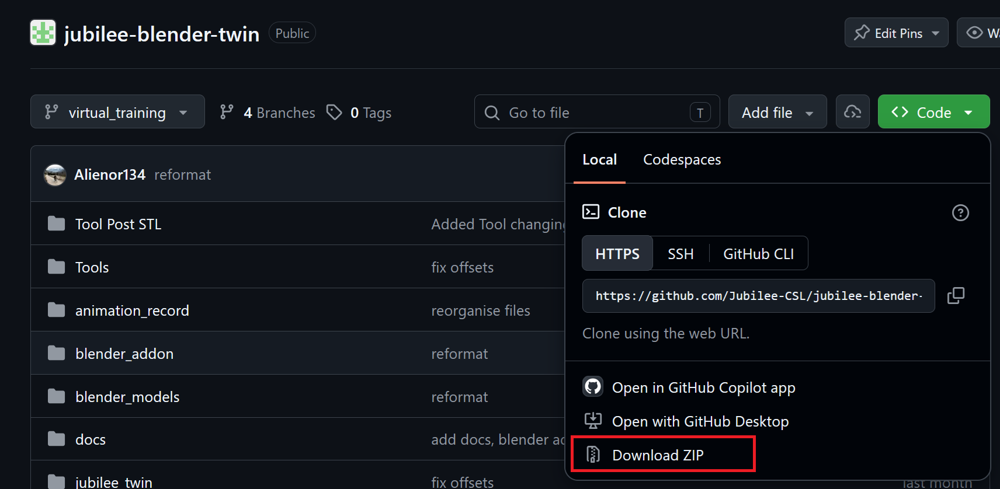

3. Extract the archive in the Smart Microscopy workshop directory.

> **Check that the `.blend` files downloaded correctly.** The 3D models are stored with Git LFS (Large File Storage) and are included in the ZIP. Open the `blender_models/` folder and confirm `jubilee_base.blend` is large (≈ 230 MB). If it is only a few hundred bytes, the download failed: ask Aliénor for the downloadable package.

Try opening `jubilee_base.blend` with Blender.

---

## Create a virtual environment

We need **Python 3.10 or newer**. Check with `python --version`
(or `python3 --version` on macOS/Linux). If Python is missing, install it from <https://www.python.org/downloads/> and tick *Add python.exe to PATH* on Windows.

Open a terminal **inside the extracted repository folder**.
- **Windows:** from the File Explorer, type `cmd` in the address bar.
- **macOS/Linux:** open a terminal and `cd` into the folder.

Then create and activate a virtual environment:

```bash
python -m venv .venv

# Windows (PowerShell)
.venv\Scripts\activate

# macOS / Linux
source .venv/bin/activate
```

The prompt now starts with `(.venv)`.

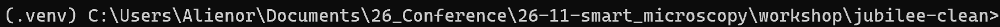

---

## Install the twin

With the virtual environment active, we install the package in editable mode:

```bash
pip install -e .
```

This installs the `jubilee-twin` command plus its dependencies (`numpy`, `PyYAML`, `colorlog`). Verify:

```bash
jubilee-twin --help
```

The list of subcommands appears (`setup-scene`, `place-tools`, `animate`, `raytrace`, `snapshot`, `scan`, `open`, …).

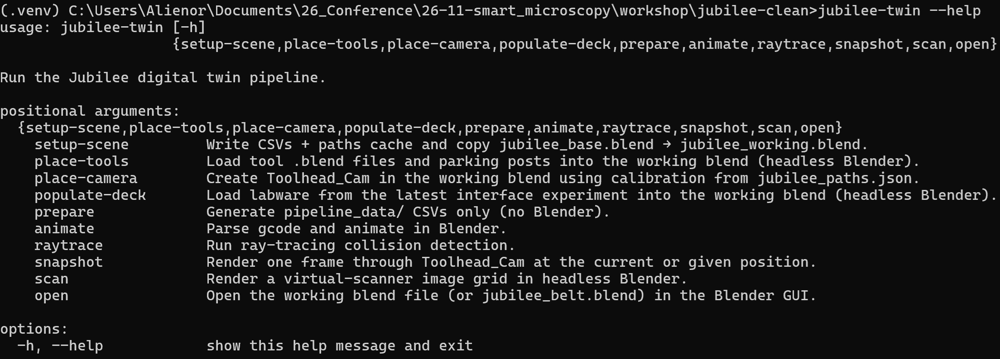
---

## Run `setup-scene`

This command builds the editable working scene used for the rest of the workshop:

```bash
jubilee-twin setup-scene
```

It will:

- copy `blender_models/jubilee_base.blend` → `pipeline_data/jubilee_working.blend`,
- write `pipeline_data/machine.json` (tool slots, park positions, offsets),
- write `pipeline_data/jubilee_paths.json` (so Blender can locate the repo),
- launch Blender in the background to place the tools and the `Toolhead_Cam` camera (placed under the toolhead so it images the machine's movements).

> For the workshop, the twin relies on **default settings** (machine state, tools, camera, deck). When working with the real Jubilee, the twin connects to the machine and copies its status and the tools mounted on it.

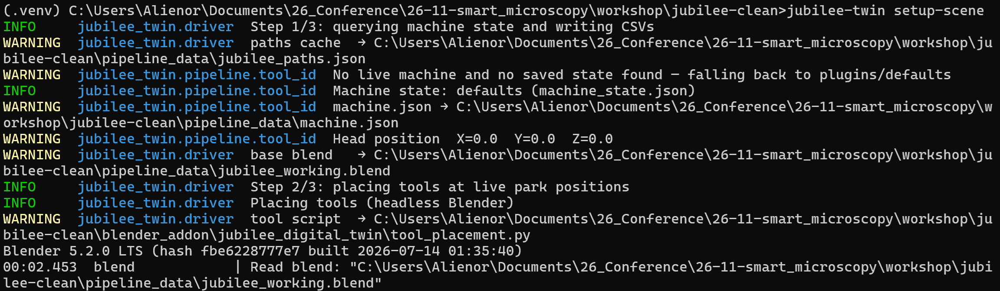

When it finishes, check that `pipeline_data/jubilee_working.blend` exists, then open it in Blender:

```bash
jubilee-twin open
```


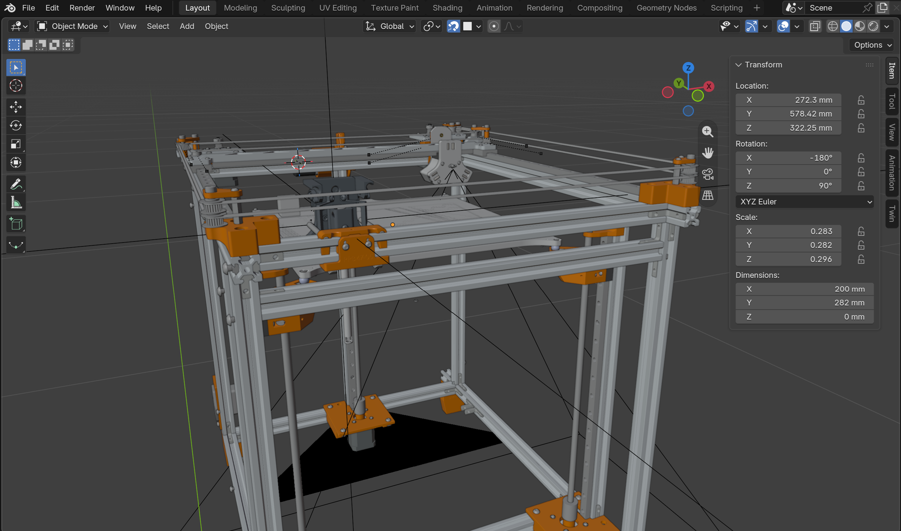
---

## Install the Blender addon

The addon adds a **Twin** tab to Blender's sidebar with buttons for moving the machine, taking snapshots, importing 3D models, animating paths, running collision detection and the virtual scanner.

1. The addon ZIP is already in the repository:
   `blender_addon/jubilee_digital_twin.zip`.
2. In Blender, open **Edit → Preferences → Add-ons**.
3. Click the **⌄** menu in the top-right corner → **Install from Disk…**.

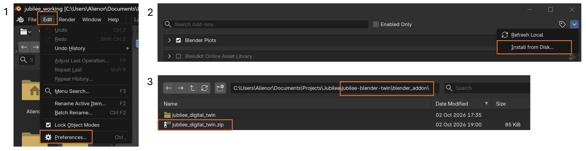

4. Select `blender_addon/jubilee_digital_twin.zip` and click **Install from Disk**.
5. Make sure the checkbox next to **Digital Twin** is ticked.

6. Back in the 3D viewport, press **N** to open the sidebar and click the **Twin** tab.

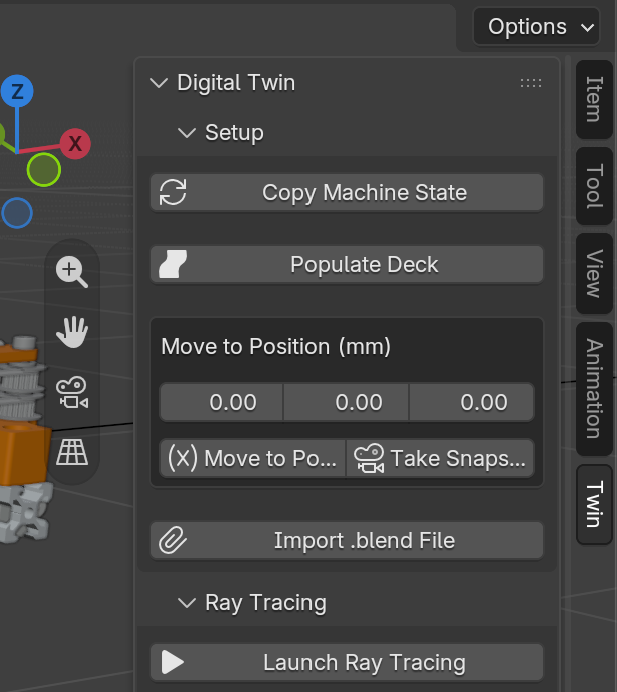
---

# Workshop tasks

Everything below happens inside Blender, in the **Twin** tab of the sidebar (press **N** in the 3D viewport if it is hidden). `pipeline_data/jubilee_working.blend` must be the file currently open; if not, run `jubilee-twin open` from the terminal.

## Task 1 — Move the machine

The digital twin reproduces the Jubilee's kinematics: the toolhead carriage moves in **X** and **Y**, and the bed moves in **Z**. We drive it like the real machine, with coordinates in millimetres.

1. In the **Twin → Setup** panel, find the **Move to Position (mm)** box.
2. Enter a target position, for example `X=150`, `Y=150`, `Z=300`. Machine boundaries are X=320, Y=330, Z=320.
3. Click **Move to Position**.


4. In the viewport, the toolhead carriage slides across the frame and the bed rises. Orbit the view (middle-mouse drag) to see it from another angle.

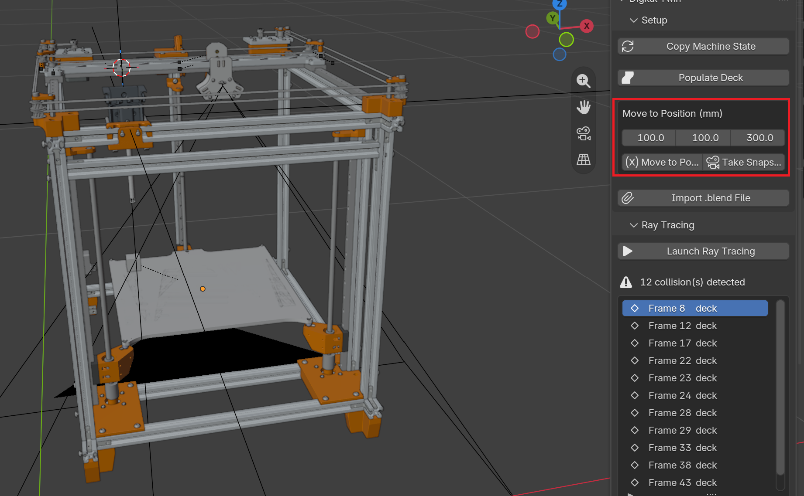

5. Try a few more positions: `X=50 Y=50 Z=100`, then `X=250 Y=250 Z=350`. The axes are clamped to the travel limits of the real machine, so an out-of-range value stops at the end of the axis.

> The status bar at the bottom of Blender confirms each move with `Moved to X=… Y=… Z=…`. The **Recent events** box at the bottom of the Setup panel shows the same log.


## Task 2 — Take a snapshot

The scene contains a camera, `Toolhead_Cam`, attached under the toolhead and calibrated to match the real machine's camera. A *snapshot* renders one image through that camera at the current machine position — the virtual equivalent of grabbing a frame from the live camera.

1. Move the machine above the deck (e.g. `X=150 Y=150 Z=300`) as in Task 1.
2. In the same **Move to Position (mm)** box, click **Take Snapshot**.


3. Blender renders the frame (a few seconds) and opens it in a **Render** window: the view of the toolhead camera from the current position.

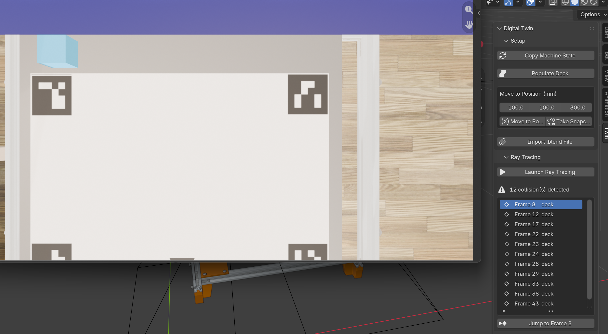

4. Close the Render window (or press **Esc**) to return to the 3D viewport.

> [!NOTE]
> **Command-line equivalent**
>
> ```bash
> # Snapshot at the current machine position, then open the image
> jubilee-twin snapshot --pop
>
> # Move to a position and snapshot in one command
> jubilee-twin snapshot --x 150 --y 150 --z 300 --pop
>
> # Choose where the image is saved
> jubilee-twin snapshot --x 150 --y 150 --z 300 --output my_snapshot.jpg
> ```
>
> `--pop` opens the rendered JPEG in the default image viewer once Blender has finished, without opening the Blender GUI.

### Where the snapshot is saved

Every snapshot is written as a JPEG inside the repository, named with the date and time it was taken:

```
jubilee-blender-twin/
└── Scans/
    └── snapshots/
        └── 20261125_143052_snapshot.jpg   ← <date>_<time>_snapshot.jpg
```

5. Move the machine to a different position, take another snapshot, and compare the two images — this is the principle behind the *virtual scanner* used in Task 4.

> If `Toolhead_Cam not found` appears, the camera was not created. Run `jubilee-twin setup-scene` from the terminal, then re-open the working file with `jubilee-twin open`.

## Task 3 — Add a 3D model to the scene

The twin is only useful if it contains what is really on the machine: labware, samples, containers. Here we add a potted basil plant to the bed and make it move with the deck.

A sample model is provided: `workshop/models/basil_plant.blend` (one object, `basil_plant`).

### Import the model

1. In the **Twin → Setup** panel, click **Import .blend File**.
2. Browse to `workshop/models/basil_plant.blend` and confirm.


The plant appears at the scene origin, inside the frame. It is selected and listed as `basil_plant` in the Outliner (top-right).

### Place it on the bed with snapping

Blender's **snapping** ("magnet") drops an object exactly onto a surface.

1. In the 3D viewport header, click the **magnet** icon to enable snapping (or press **Shift+Tab**).
2. Open the dropdown next to the magnet and set **Snap To → Face Project**. Leave **Snap Base** on **Closest**.

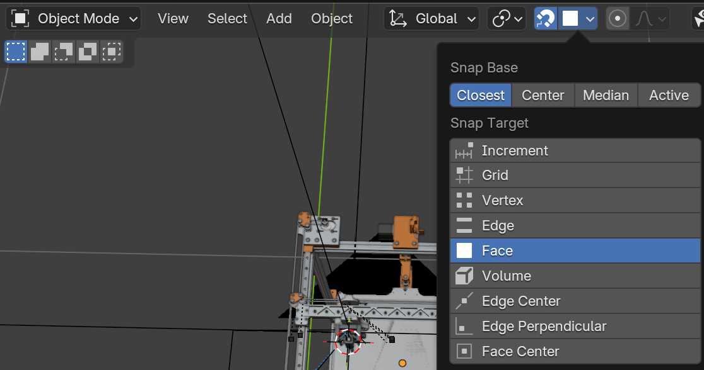

3. With `basil_plant` selected, press **G** and move the mouse over the bed plate: the plant sticks to the surface and follows the cursor. Click to drop it.


### Parent it to the bed

At this point the plant simply sits at the bed height; if the bed moved, it would stay behind. Parenting attaches it to the bed so they move together, like a real pot resting on the real deck.

1. Click `basil_plant` to select it.
2. **Shift+click** the bed plate, `z_plate_3_V5`, to add it to the selection (it becomes the *active* object, highlighted lighter). If it is hard to click in the viewport, type `z_plate` in the Outliner search box and **Ctrl+click** it there.
3. Press **Ctrl+P → Object (Keep Transform)**.

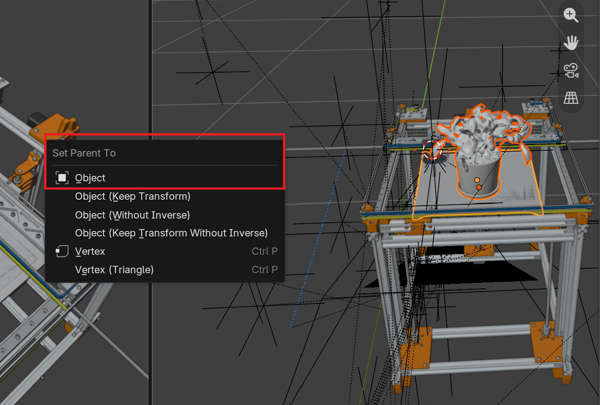

In the Outliner, `basil_plant` is now nested under `z_plate_3_V5`.

### Check it follows the machine

In **Twin → Setup**, set `Z=250` and click **Move to Position**: the bed goes down and the plant goes with it.

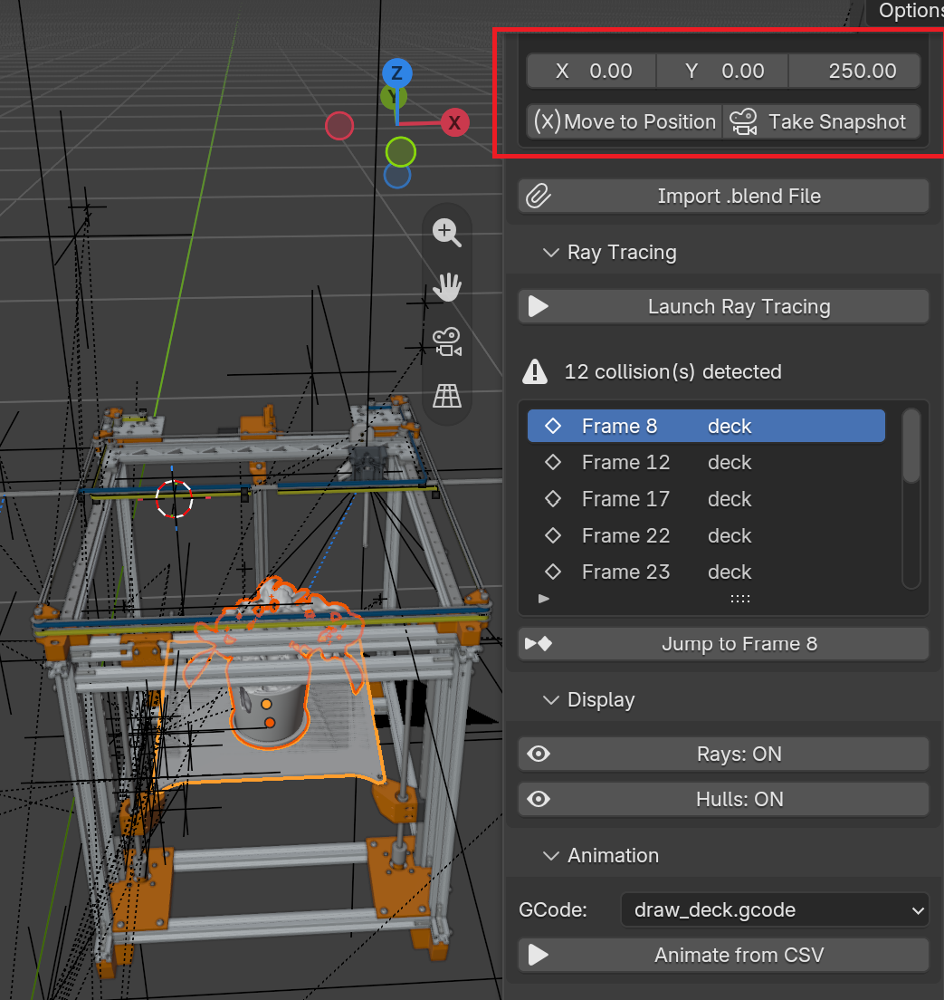

## Task 4 — Virtual scan of the bed

A *virtual scan* drives the toolhead camera over a grid of positions and renders one image at each. It produces the same kind of image dataset the real machine would acquire when scanning the deck — in minutes, with known camera poses, and before anything is placed on the real bed.

### Set up the grid

1. Open the **Twin → Virtual Scanner** panel.
2. Enter the following values:
   | Axis | min | max | steps |
   |---|---|---|---|
   | X | 110 | 250 | 4 |
   | Y | 80 | 200 | 4 |
   | Z (bed) | 280 | 320 | 2 |

   **Total frames** updates accordingly: 4 × 4 × 2 = 32 images.
3. Set the image size **W × H**. Leave `1920 × 1056` to match the real camera, or lower it (e.g. `640 × 352`) for a faster render.

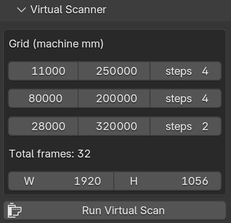

### Run the scan

1. Click **Run Virtual Scan**.
2. Blender freezes while rendering. The machine jumps from position to position and one JPEG is saved per frame, a few seconds each, dut does not move inside the interface. Progress is printed in the terminal Blender was launched from.
3. When it finishes, the panel shows the output folder under **Last:** and the status bar reports `Scan complete: …`.

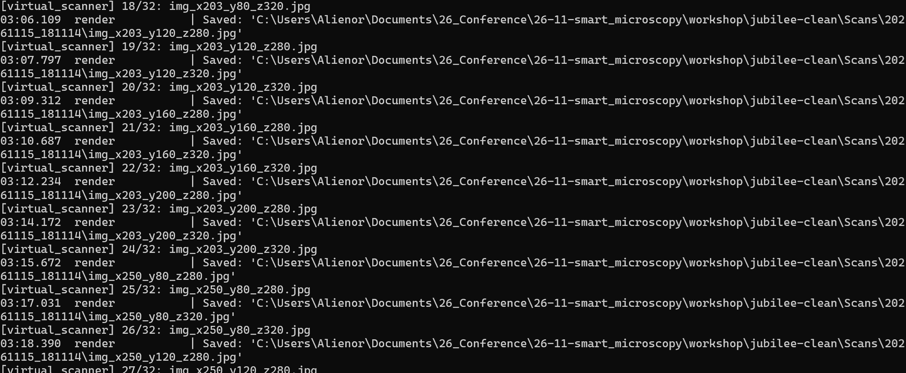

### Where to find the scan

Each scan gets its own time-stamped folder in `Scans/` at the repository root:

```
jubilee-blender-twin/
└── Scans/
    └── 20261125_150312/            ← one folder per scan
        ├── img_x110_y80_z280.jpg   ← one image per grid point: img_x{X}_y{Y}_z{Z}.jpg
        ├── img_x157_y80_z280.jpg
        ├── …
        ├── camera.yaml             ← camera intrinsics (fx, fy, cx, cy, distortion, offset) + image size
        └── manifest.json           ← grid definition + camera pose for every frame
```

Flipping through the images, the basil plant placed in Task 3 appears, shifts and leaves the frame as the camera moves across the grid. `manifest.json` ties each file name to the exact machine position and camera pose it was rendered from. It contains the images metadata and helps to use the dataset for stitching, calibration or training.

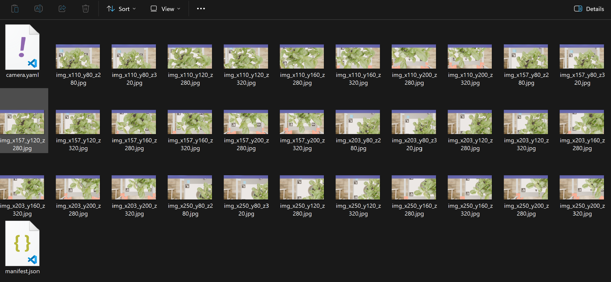

> [!NOTE]
> **Command-line equivalent**
>
> Same scan, headless (no Blender window), with the grid given as arguments:
>
> ```bash
> jubilee-twin scan --x-min 110 --x-max 250 --x-steps 4 --y-min 80 --y-max 200 --y-steps 4 --z-min 280 --z-max 320 --z-steps 2
> ```
>
> Omitted arguments take the addon defaults (5 × 5 × 3 grid, 1920 × 1056). `--width 640 --height 352` speeds up rendering; `--output-root PATH` writes somewhere other than `Scans/`. The output folder is printed at the end: `[virtual_scanner] Output: …\Scans\<date>_<time>`.

## Task 5 — Animate a G-code program

So far we have moved the machine by hand. The twin can also replay a whole sequence of movements that the robot will reproduce. First the movements are executed with the robot module in virtual mode, and every command is recorded as a G-code file. The digital twin reads this G-code file and plays the animation. This lets us preview an experiment, check the trajectory and spot collisions *before* running it on the machine.

A sample program is provided in the repository: `workshop/gcode_logs/draw_deck.gcode`. It picks up **tool 1**, draws two rectangles on the deck, then parks the tool again.

### Tell Blender where the G-code is

The addon lists G-code files from `<jubilee_dir>/pipeline_data/gcode_logs/`. With a real Jubilee, `jubilee_dir` is filled in automatically by the machine software; in the workshop we set it by hand.

1. Create the folder `pipeline_data/gcode_logs/` in the repository and copy `workshop/gcode_logs/draw_deck.gcode` into it.
2. Open `pipeline_data/jubilee_paths.json` in a text editor and add a `jubilee_dir` line with the **same path as `twin_dir`**:

   ```json
   {
     "twin_dir": "C:/Users/you/Documents/jubilee-blender-twin",
     "jubilee_dir": "C:/Users/you/Documents/jubilee-blender-twin",
     ...
   }
   ```

   Use forward slashes `/` (or doubled backslashes `\\`) in the path, and keep the comma at the end of the line.

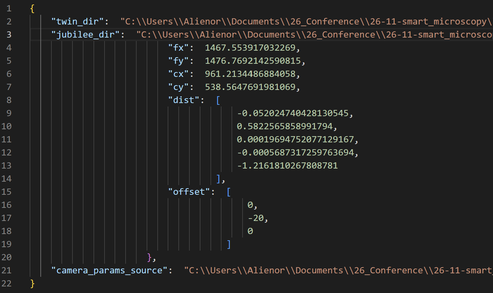


> Running `jubilee-twin setup-scene` again rewrites this file; the line must then be re-added.

### Play the animation in Blender

1. In Blender, open the **Twin → Animation** panel.
2. In the **GCode** dropdown, select `draw_deck.gcode`.
3. Click **Animate from CSV**. The addon parses the G-code, keyframes the X/Y/Z axes and sets the timeline length.

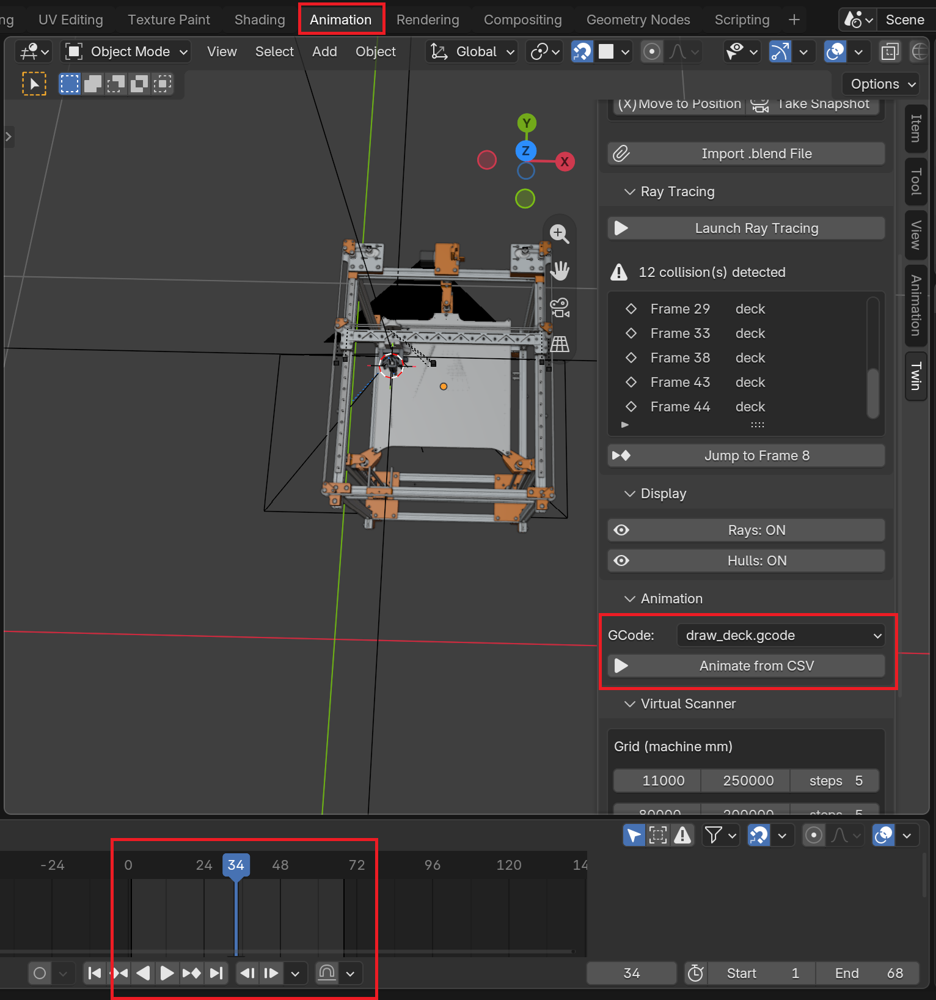

4. Press **Space** in the 3D viewport (or ▶ in the timeline at the bottom) to play. The carriage travels to the tool rack, picks up tool 1, traces the two rectangles above the deck, and parks the tool.

> [!NOTE]
> **Command-line equivalent**
>
> ```bash
> jubilee-twin animate workshop/gcode_logs/draw_deck.gcode --interactive
> ```
>
> Parses the G-code, bakes the animation and opens the result in Blender. `--step 10` gives a smoother animation (default: one keyframe every 50 mm). Without `--interactive`, Blender runs headlessly and saves into `pipeline_data/jubilee_working.blend`.

5. To change the trajectory, open `pipeline_data/gcode_logs/draw_deck.gcode` in a text editor, edit a few `X`/`Y` coordinates of the rectangles (within the machine boundaries), save, then click **Animate from CSV** again. The file also contains G-code for the tool-change sequence, which picks up and detaches the tool from the toolhead.

> Once the scene is animated, the timeline drives the axes: **Move to Position** still moves them in the viewport, but **Take Snapshot** and **Run Virtual Scan** render at the keyframed position of the current frame. To return to manual control, select `X-axis`, `Y-axis` and `Z-axis` in the Outliner and press **Alt+I → Clear Keyframes** in the 3D viewport.

## Task 6 — Collision detection by ray tracing

With the trajectory animated and the plant on the bed, we can ask the question the twin exists for: *will the machine hit something?* The addon answers it by ray tracing the animation of Task 5 against everything static in the scene.

### How it works: the convex envelope

The moving assembly — gantry, XY carriage and the mounted tool — is made of thousands of faces, far too many to test against the scene at every frame. Instead, the addon wraps it in its **convex hull**: the smallest convex shape that contains every vertex, as if the assembly were shrink-wrapped. The hull has only a few dozen vertices and is computed once per head state — `Gantry_hull` when no tool is mounted, `Inoculator_hull` once tool 0 is picked up — so the envelope changes at each tool change.

At each frame of the animation:

1. the displacement of the head to the next frame gives a direction and a length;
2. from every vertex of the current hull, a **ray** is cast along that direction, over that length (when the head does not move, a short 1 cm ray is cast downwards instead);
3. the moving parts are hidden during the cast, so a ray can only hit *static* geometry: bed, frame, tool posts, labware, the plant;
4. every hit is recorded as a collision at that frame, with the name of the object that was hit.

The hull is a conservative approximation: it fills the hollows of the real assembly, so it can flag a near-miss as a collision, but a hull vertex sweeping through an object is never missed. Rays are only cast from the vertices, so an object thin enough to pass between two vertices can slip through — the keyframe spacing (`--step`) and the hull resolution set the sensitivity.

### With the plant

1. Scrub the timeline to a frame where the tool is drawing a rectangle (around frame 35), then move the plant under the tool: select `basil_plant`, press **G** and, with snapping still on **Face Project**, drop it on the bed below the toolhead.
2. Open the **Twin → Ray Tracing** panel and click **Launch Ray Tracing**. Blender freezes for a few seconds while it steps through the 68 frames. Meanwhile, the CLI gives details on the raytracing running. 
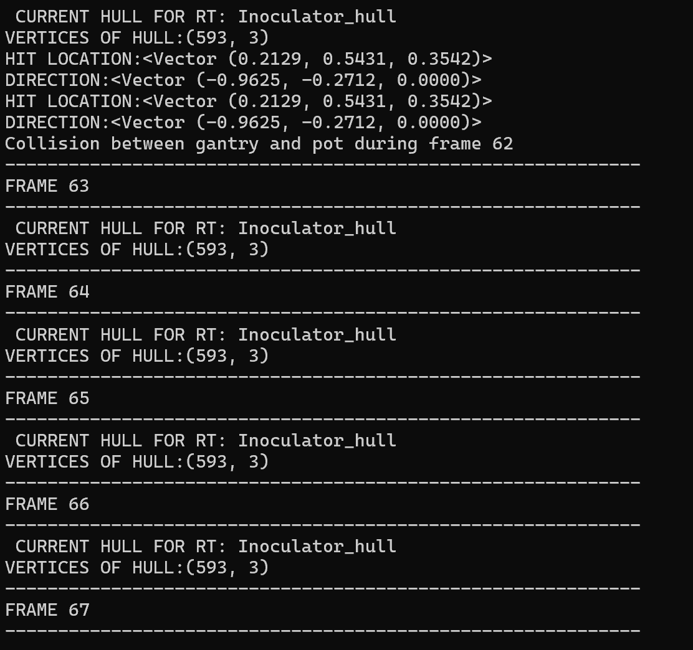

3. The panel reports **N collision(s) detected** and lists one entry per frame. Select an entry and click **Jump to Frame** to see the toolhead intersecting the plant.

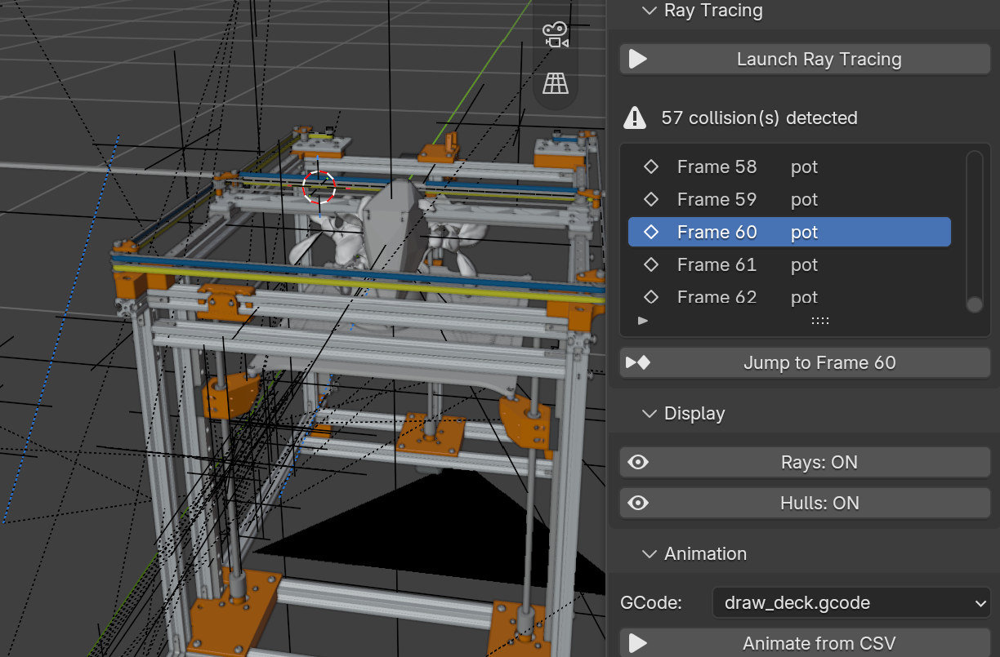

4. In **Twin → Display**, click **Toggle Hulls**. The envelope of the current head state appears as a translucent shape around the carriage; scrubbing the timeline, it switches from `Gantry_hull` to `Inoculator_hull` at the tool pickup and back at the park move.


### Without the plant

1. Select `basil_plant` and press **X → Delete** (or **Delete**) to remove it from the scene. Hiding it with the eye icon is not enough: the rays are cast against the evaluated scene, hidden objects included.
2. Click **Launch Ray Tracing** again.
3. The panel now reports no collision detected on the bed. The collisions happen with the belt of the motor that do not move with the machine yet (work in progress).


> [!NOTE]
> **Command-line equivalent**
>
> Save the scene first (**Ctrl+S**) so the current deck contents are part of the working file, then:
>
> ```bash
> # Parse the G-code, animate and ray trace, then open the result in Blender
> jubilee-twin raytrace workshop/gcode_logs/draw_deck.gcode --interactive
>
> # Reuse the existing pipeline_data/ (pathout.csv, machine.json), headless
> jubilee-twin raytrace
> ```
>
> Each collision is printed as `Collision between gantry and <object> during frame <N>`. Without `--interactive`, the hulls and the collision list are saved into `pipeline_data/jubilee_working.blend`.

---

## Acknowledgements

Thank you to Inès Bouzigarene, Quentin Florent, Justin Verastegui and POSE workshop participants for making this tutorial possible with their contributions. 

## Troubleshooting

| Symptom | Fix |
|---|---|
| `blender: command not found` / `'blender' is not recognized` | Blender is not on PATH. Open a **new** terminal after editing PATH, or pass `--blender "<full path to blender.exe>"`. |
| `jubilee-twin: command not found` | The venv is not active. Run `.venv\Scripts\activate` (Windows) or `source .venv/bin/activate` again. |
| `jubilee_base.blend` is tiny / Blender says "file is not a Blender file" | The LFS asset was not downloaded. Re-download the ZIP from GitHub and check the file is ≈ 230 MB. |
| Addon does not appear in the **Add-ons** list after installing | Make sure the `.zip` was selected, not the folder. Search for "Digital Twin" in the Add-ons search box. |
| **Twin** tab missing in the sidebar | Press **N** in the 3D viewport, and confirm the addon checkbox is ticked in Preferences. |
| Buttons in the Twin panel fail with a path error | Run `jubilee-twin setup-scene` first — the addon reads `pipeline_data/jubilee_paths.json`. |
| **Animate from CSV** does nothing / `pathout.csv` not found | Select a file in the **GCode** dropdown first, or run `jubilee-twin prepare workshop/gcode_logs/draw_deck.gcode` in the terminal. |
| **GCode** dropdown only shows `— run jubilee-twin setup-scene —` | `jubilee_dir` is missing from `pipeline_data/jubilee_paths.json`, or `pipeline_data/gcode_logs/` has no `.gcode` file. See **Tell Blender where the G-code is** in Task 5. |
| The plant does not stick to the bed when moving it | Snapping is off, or **Snap To** is not set to **Face Project**. Check the magnet icon is highlighted. |
| The plant stays behind when the bed moves | It was not parented. Select the plant, Shift+click `z_plate_3_V5`, **Ctrl+P → Object (Keep Transform)**. |
| **Import .blend File** added lots of objects / a second machine | A full scene was imported (e.g. `blender_models/basil_plant.blend`). **Ctrl+Z**, then import `workshop/models/basil_plant.blend` instead. |
| **Take Snapshot** / **Run Virtual Scan** render the bed at the wrong height | The scene is animated (Task 5): renders use the keyframed position. Select `X-axis`, `Y-axis`, `Z-axis` → **Alt+I → Clear Keyframes**, then move and render again. |
| **Run Virtual Scan** fails with `Toolhead_Cam not found` | Run `jubilee-twin setup-scene` (or `jubilee-twin place-camera`) in the terminal, then `jubilee-twin open`. |
| The scan takes too long | Reduce **steps** (e.g. 3 / 3 / 1) and image size (e.g. 640 × 352). Blender is unresponsive until the scan finishes. |
| **Launch Ray Tracing** still reports collisions after hiding the plant | Hiding (eye icon) does not exclude an object from the rays. Select `basil_plant` and press **X → Delete**, then run again. |
| **Toggle Hulls** shows nothing | Run **Launch Ray Tracing** first — the hulls are created by the ray-tracing pass. |

For the full documentation (CLI reference, collision detection, virtual
scanner, GIF recording) see the main [README](../README.md).
